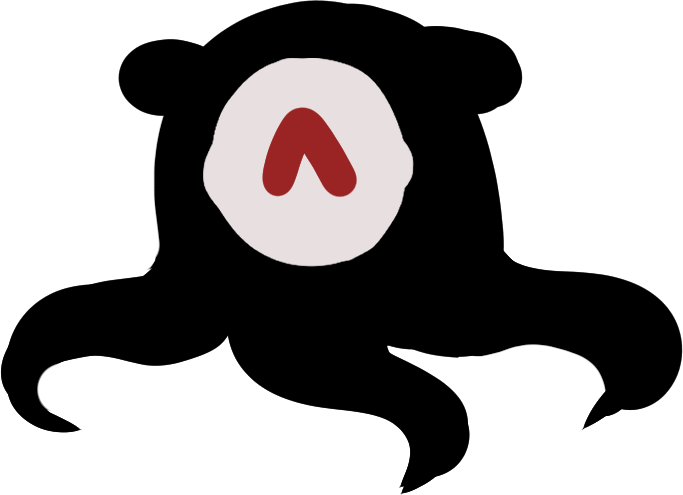
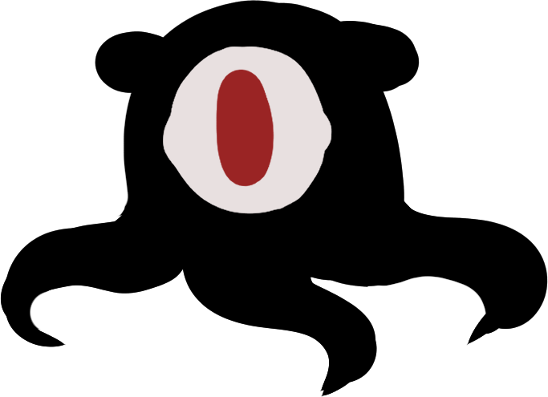
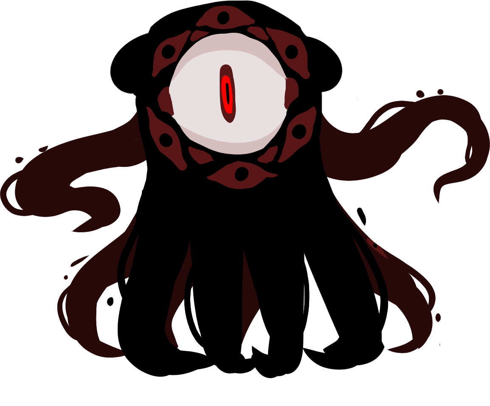
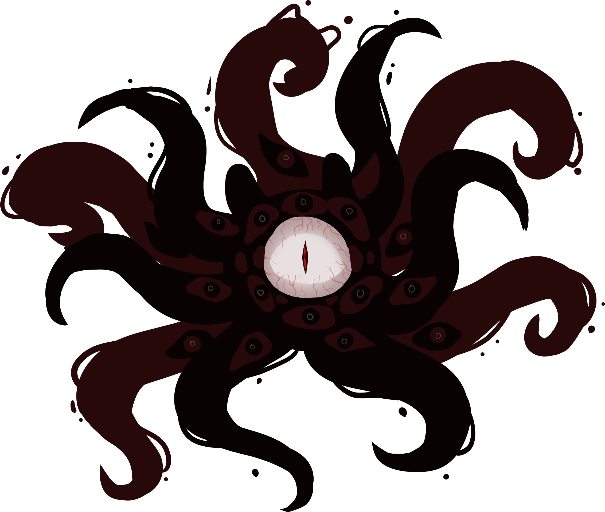
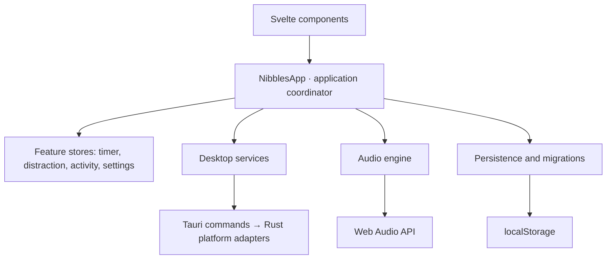

<div align="center">
  
  <h1>Nibbles</h1>
  <p><strong>Stay focused. Keep the familiar calm.</strong></p>
  <p>A Pomodoro desktop companion that grows when you get distracted.</p>
  <p>
    
    
    
    
  </p>
</div>

Nibbles turns focus sessions into a small ritual: choose your work apps, start the timer, and keep your eldritch familiar calm. When you switch to a distracting window, productive time freezes and Nibbles transforms into increasingly demanding forms. Return to your work and it settles down.

The project combines a character-driven interface with native desktop integration, reactive state management, procedural audio, and a local activity dashboard.

## Features

| Feature | What it does |
| --- | --- |
| **Distraction-aware Pomodoro** | Freezes focus time while a distracting window is active and resumes when you return to an allowed window. |
| **Four creature forms** | Escalates from a calm companion to a large final form, with animated transformations and a growing desktop window. |
| **Flexible window rules** | Supports whitelist and blacklist modes with case-insensitive app or browser-tab title phrases. Add the last observed window directly from settings. |
| **Custom focus rituals** | Set focus sessions from 1–180 minutes, breaks from 1–90 minutes, and optional flow overtime that counts upward after focus ends. |
| **Configurable reminders** | Adjust growth speed and final-form pop-ups. Optionally minimize the distracting window after a delay in the final form. Automatic minimization is off by default. |
| **Activity dashboard** | View seven-day focus and break totals, daily comparison bars, average focus duration, and recent sessions filtered by phase. |
| **Synthesized sound** | Choose from three focus ticks and three ambient break moods, with previews, independent toggles, and a shared volume control. |
| **Floating desktop widget** | A transparent, frameless companion with dragging, an always-on-top toggle, and an expandable, resizable settings panel. |
| **Local persistence** | Saves preferences and session history on the device, with validation and migration of older saved data. |

## Meet the familiar

<table>
  <tr>
    <th align="center">Form 1 · Calm</th>
    <th align="center">Form 2 · Distracted</th>
    <th align="center">Form 3 · Growing</th>
    <th align="center">Form 4 · Final warning</th>
  </tr>
  <tr>
    <td align="center"></td>
    <td align="center"></td>
    <td align="center"></td>
    <td align="center"></td>
  </tr>
</table>

During productive focus, Nibbles reads a little book. A distraction triggers the second form immediately; continued distraction advances through the remaining forms at the configured growth interval. The default interval is 15 seconds.

### A typical session

1. Open **Settings** and choose whitelist or blacklist mode. Add title phrases such as `Visual Studio Code`, `Figma`, or a document name.
2. Set your focus and break durations. The defaults are **25 minutes of focus** and **5 minutes of rest**.
3. Start the timer. During focus, Nibbles evaluates the active window against your rules.
4. Switch to a distracting window and the countdown freezes while the familiar grows. Return to an allowed window to reset the warning and resume focus.
5. With **Flow overtime** enabled, keep working past zero and use **Skip to break** when ready. With overtime disabled, the timer transitions automatically.
6. Open **Activity** to review your sessions and recent focus patterns.

## Tech stack

| Layer | Technology | Role |
| --- | --- | --- |
| Interface | **Svelte 5 + TypeScript** | Reactive feature stores using runes, typed component props, and reusable UI components. |
| Frontend tooling | **SvelteKit 2 + Vite 6** | Development server and static SPA build with server-side rendering disabled. |
| Desktop shell | **Tauri 2** | Native window management and communication between the interface and Rust commands. |
| Native integration | **Rust** | Platform-specific foreground-window detection and optional window minimization. |
| Audio | **Web Audio API** | Oscillators, gain envelopes, filters, and chord transitions generated at runtime. |
| Persistence | **localStorage** | Versioned JSON snapshots of settings and activity, with v2-to-v3 migration. |
| Visuals | **CSS + SVG + PNG assets** | Creature animations, a radial timer indicator, transparent layers, and character artwork. |

## Architecture and technical highlights



- **Feature-based state ownership.** Timer, distraction, activity, and settings each own their state and rules. [`NibblesApp`](src/lib/app/nibbles.svelte.ts) connects them to services, keeping rendering, business logic, and side effects separate.
- **Explicit timer transitions.** [`TimerStore`](src/lib/features/timer/timer.svelte.ts) manages focus, breaks, pauses, and overtime. Overtime updates the existing completed session when it ends, avoiding duplicate history entries.
- **Separate timing loops.** Foreground-window polling runs every **600 ms**, while productive time advances every **1 second**. During a distraction, only warning escalation advances.
- **Small native command surface.** Rust exposes two commands: `get_foreground_window_title` and `minimize_foreground_window`. Matching policy stays in TypeScript; platform adapters handle the operating system APIs. Minimization re-checks the foreground title before acting.
- **Procedural audio.** Focus ticks use short oscillator envelopes. Break soundscapes combine three detuned voices, a low-pass filter, and gradual chord changes. Sound is generated locally without audio downloads.
- **Resilient saved state.** Persistence validates stored values, migrates the older flat schema into feature snapshots, and falls back to defaults when data cannot be read. Storage failures do not interrupt the timer.
- **Browser-safe services.** Desktop adapters tolerate unavailable native APIs, allowing the interface, timer, settings, and audio to run in a browser during UI development.

### Project structure

```text
src/
├── routes/                    # SvelteKit entry point and app lifecycle
└── lib/
    ├── app/                   # Application coordinator
    ├── components/
    │   ├── widget/            # Companion, progress, controls, warnings
    │   ├── menu/tabs/         # Activity, ritual settings, sound settings
    │   └── ui/                # App layouts and shared icons
    ├── features/
    │   ├── timer/             # Focus/break state machine and helpers
    │   ├── distraction/       # Window rules and warning escalation
    │   ├── activity/          # Session history and statistics
    │   └── settings/          # Defaults, validation, and preferences
    └── services/
        ├── audio/             # Audio lifecycle, ticks, ambient synthesis
        ├── desktop/           # Tauri window and foreground adapters
        └── persistence/       # Saved snapshots and schema migrations
src-tauri/
├── src/commands/              # Commands callable from the frontend
├── src/platform/              # Native OS implementations and fallbacks
├── capabilities/              # Tauri permission configuration
└── tauri.conf.json            # Window, build, and bundle configuration
static/                        # Creature artwork and app assets
```

## Run locally

### Prerequisites

- **Node.js 22+** and **npm**.
- **Rust stable** and **Cargo** for the desktop app.
- Your operating system's native build dependencies. Follow the [Tauri prerequisites guide](https://v2.tauri.app/start/prerequisites/) for Windows build tools and WebView2, macOS Command Line Tools, or Linux system packages.

### Desktop app

```sh
git clone https://github.com/Kreipri/pomodoro-clock.git
cd pomodoro-clock
npm ci
npm run tauri dev
```

If PowerShell blocks `npm.ps1`, use `npm.cmd` in place of `npm`.

### Browser preview

```sh
npm run dev
```

Open [localhost:1420](http://localhost:1420). Foreground-window detection and native window controls require the desktop app; the browser preview keeps focus time running without desktop monitoring.

### Useful commands

| Command | Purpose |
| --- | --- |
| `npm run tauri dev` | Run the desktop app with frontend development updates. |
| `npm run dev` | Run the frontend in a browser. |
| `npm run check` | Check Svelte and TypeScript diagnostics. |
| `npm run build` | Build the static frontend into `build/`. |
| `npm run preview` | Preview the built frontend. |
| `npm run tauri build` | Build the native app and platform bundles. |

Desktop bundles are generated under `src-tauri/target/release/bundle/` for the build platform.

## Platform behavior

| Environment | Foreground monitoring and distraction response |
| --- | --- |
| **Windows** | Implemented using Win32 foreground-window title and minimization APIs. |
| **macOS** | Implemented using Cocoa and Accessibility APIs. Window-title access and window minimization depend on Accessibility permission; app-name detection can still work when a title is unavailable. The minimization action falls back to hiding the app if needed. |
| **Linux / other desktop targets** | Native monitoring currently returns an empty title and minimization is unavailable. The timer continues without distraction enforcement. |
| **Browser** | UI preview with native monitoring and window controls unavailable. |

On macOS, enable Accessibility access for the running app in **System Settings → Privacy & Security → Accessibility** when using window-level monitoring and minimization.

## Privacy and data

Window matching happens on the device using the visible foreground-window title and, on macOS, the app name. Nibbles does not inspect page contents, browser history, or URLs directly; browser rules work through text exposed in the active window's title.

Settings and activity are stored locally in the app's webview storage. Foreground titles are used in memory for matching and display and are not included in saved session history. The app requires no account or backend service.

Activity retains up to **100 sessions** and excludes sessions lasting **five minutes or less**. Charts summarize that retained history. Preferences and recorded activity survive restarts; a running timer starts fresh when the app reopens.
